# 生息 · Sense Murmur

**和一个人相识，和一群人有故事。**

把几个角色放进同一个群里：有人认同观点却不信任提出观点的人，有人嘴上反对却仍然护短；一次插话岔开了话题，先前没回答的问题还在。《生息》让这样的互动留在关系与共同经历里，成为下次相处的背景。

这是一款围绕 **多角色互动、持续关系和共同经历** 设计的 AI 聊天应用。角色有各自的人格、记忆与知情范围；一个角色相信的事、大家共同确认的事、仍在商量的事，不会被混成同一种“聊天记录”。你可以只和一个角色说话，也可以让一群熟悉的人走进故事房、学习房，继续做他们自己。

[在线体验](https://sense.lyixi.com) · QQ 群：571886312 · [English](./README.en.md)

<a href="./pictures/聊天1-羊肉火锅.PNG">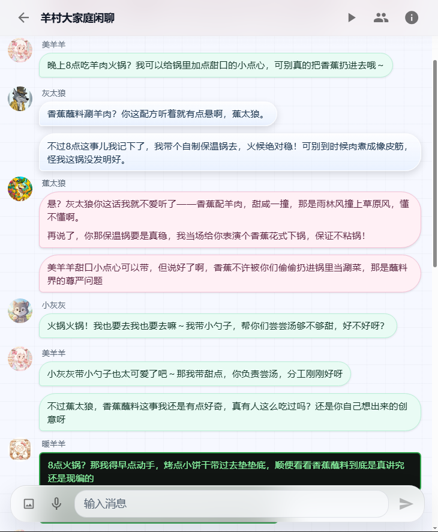</a>

适合喜欢原创角色（OC）与群像、想长期经营角色关系，或想和人物共同写故事、学习创作的人。

### 第一次使用，从这里开始

1. 打开在线体验，选择本地模式或登录账号。
2. 在设置中选择一个可用的文本模型；没有模型时，仍可以先浏览界面、角色库和示例内容。
3. 从一个角色开始单聊。想看生息与普通 AI 聊天的区别，再把这个角色和其他人物放进群聊，观察他们如何记住彼此、保留分歧并继续未完的话题。

角色、房间和聊天优先保存在本地；登录与云同步是可选的。AI 生成需要可用模型和网络，具体模型、语音、图片与 Agent 能力取决于你的账号和设置。

## 一个群里，可以同时发生几件事

**群聊有当前主线，也容得下尚未说完的支线。** 当前话题、具体矛盾、关系变化、角色成长与用户引导会形成不同的叙事线。每条线保留相关人物与发生依据，参与后续发言的安排与生成；你也可以在叙事面板回看它们从哪里来。

比如，一群人正在商量出行：甲还在等乙回答是否参加，丙插话提议改地点，丁介意的却是自己总被排除在决定之外。系统会分别保留待回应的问题、尚未确认的计划与关系上的分歧，为后续接回这些线索提供依据。丙的提议也不会替乙作出决定。

- **角色会彼此交谈。** 发言参考话题、关系、点名和最近互动。被点名者尚未回答时，第三人插话不会直接抹掉这份回应期待；角色仍可以接话、稍后回应或选择沉默。
- **事情有各自的进展。** 提议、接受、撤回与完成有所区分；把任务派给一个角色，并不意味着对方已经答应。
- **降温和解决是两回事。** 情绪可以慢慢平复，分歧仍可保留；已经解决的事项则退出当前压力，让交流有机会自然收束。
- **你可以在场，也可以执导。** 作为成员加入，或从旁指定谁回应、注入事件、改变方向，观察人物如何应对。

群里可以有几个同时展开的关注点，却不要求每个人按顺序答完，也不要求每轮都制造冲突。具体接话仍由模型结合人物与处境生成；平静的闲聊同样可以留下属于这群人的默契。

更多群聊画面

**围绕作文的讨论**

<a href="./pictures/聊天2-高考作文.PNG">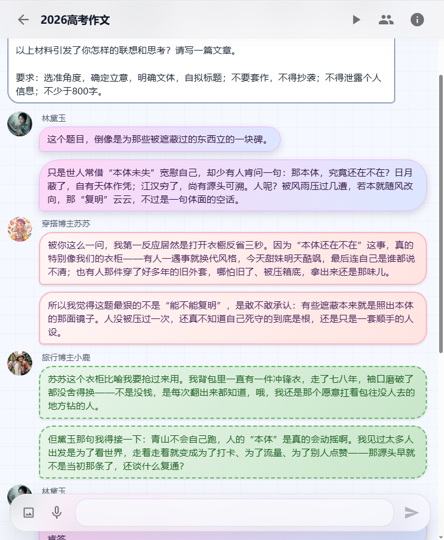</a>

**不同角色碰面**

<a href="./pictures/聊天4-林黛玉与鲁智深.PNG">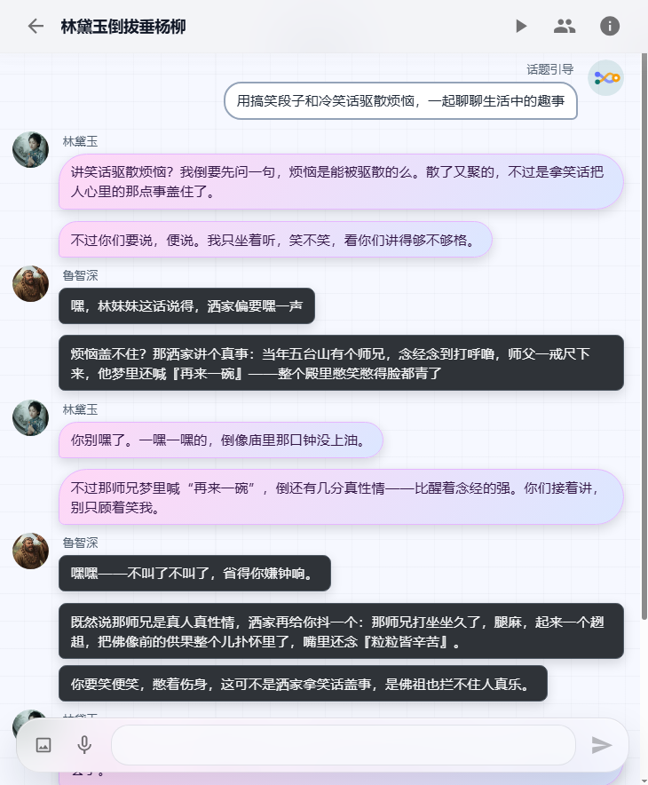</a>

**群聊成员与场景**

<a href="./pictures/编辑群聊.PNG">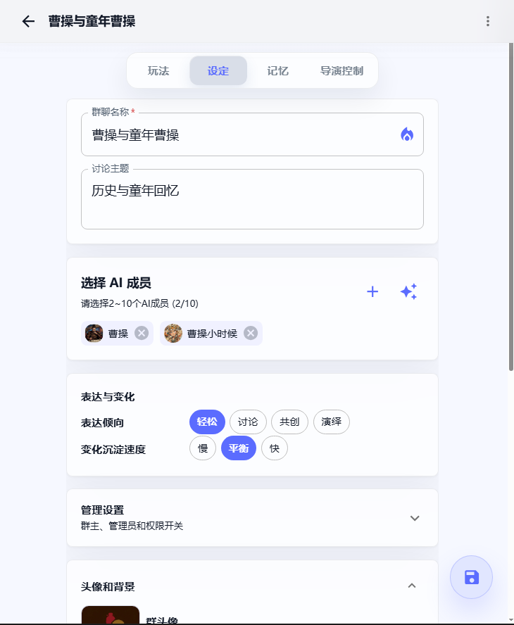</a>

单段对话也可以打开 AI 分析，回看角色表面说了什么、话里的转折与它回应的上下文线索。

<a href="./pictures/对话AI深层分析.PNG">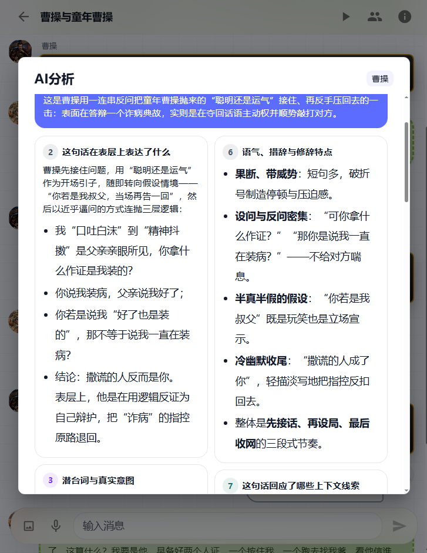</a>

## 关系可以复杂，也可以不对等

**甲欣赏乙，不代表乙也欣赏甲；信任一个人，也不代表愿意向他让步。**

角色关系分别记录亲和、能力判断、信任、威胁感、在意和让位倾向。因此，“认可能力却不信任”“很在意却仍然防备”“亲近但拒绝服从”都能作为相处的底色。每个方向分别记录的是 **一个人如何看待另一个人**；亲属、同事、上下级、同阵营等共同身份则另外保留。人物可以误解彼此，但她的猜测不该自动变成所有人的事实。

关系图让你看清谁与谁有联系，以及各自怎样看待对方；关系变化记录对应的互动与依据。一次赞同不会自动变成结盟，一句反驳也不会自动变成仇恨。已有关系会随角色带入其他房间，房间也保留本次相处留下的变化依据。

眼前情绪与长期关系分开处理：一句重话可能带来委屈、防备或找补的冲动，但不应轻易抹掉长期信任。同一句话也会因说话者、听话者和共同历史不同而有不同分量。这样的设计给护短、嘴硬、试探与修复留下空间。

<a href="./pictures/聊天-关系脉络.PNG">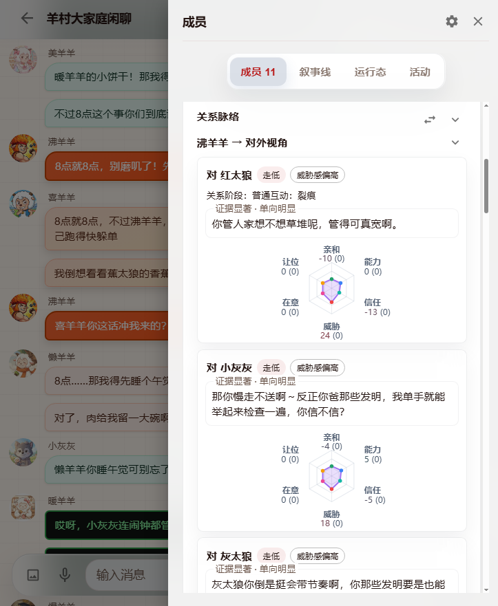</a>

## 从一句设定，建立一组人物

你可以逐项编辑角色，也可以从故事、剧本或描述批量提取人物，再选择要建立的角色和关系。人物资料不止名字与人设简介：还可以整理人格、性格参数、表达习惯、价值取向、核心欲望与恐惧，并设置外观、头像和语音。

已有角色可以组成家庭、社团、对立阵营或故事群像。批量创建还会分析人物间有依据的关系：共同目标里可能有利益分歧，职责与私情也可能互相牵制。你可以继续修改人物与群体关系，为故事准备一个有来处的开局。

**从角色库挑选，也能逐项编辑。**

更多角色创建与编辑画面

<a href="./pictures/编辑角色.PNG">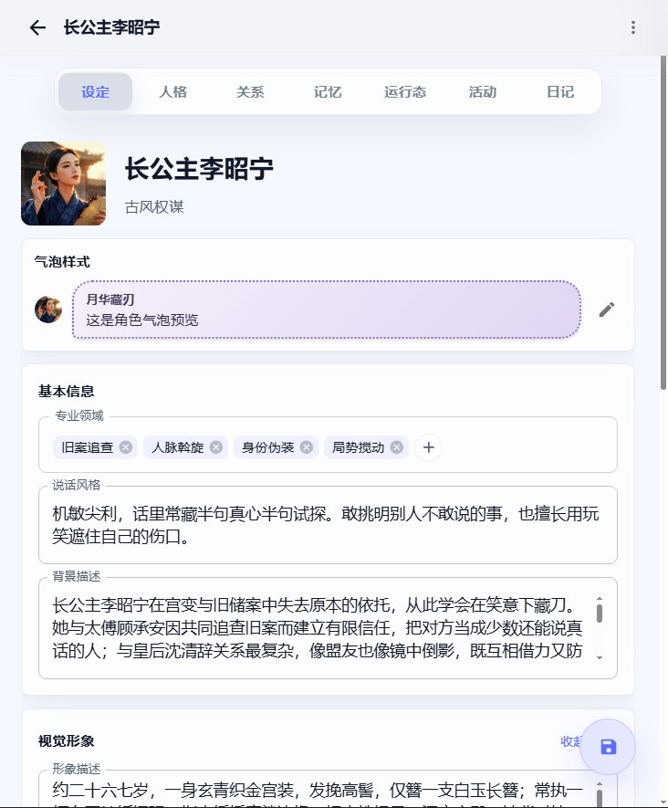</a>

**性格与人格可以继续细调。**

<a href="./pictures/编辑角色-性格.PNG">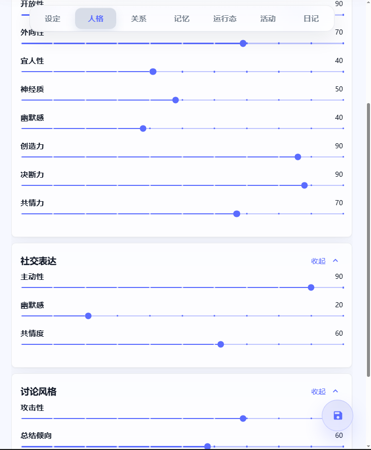</a>

<a href="./pictures/编辑角色-人格.PNG">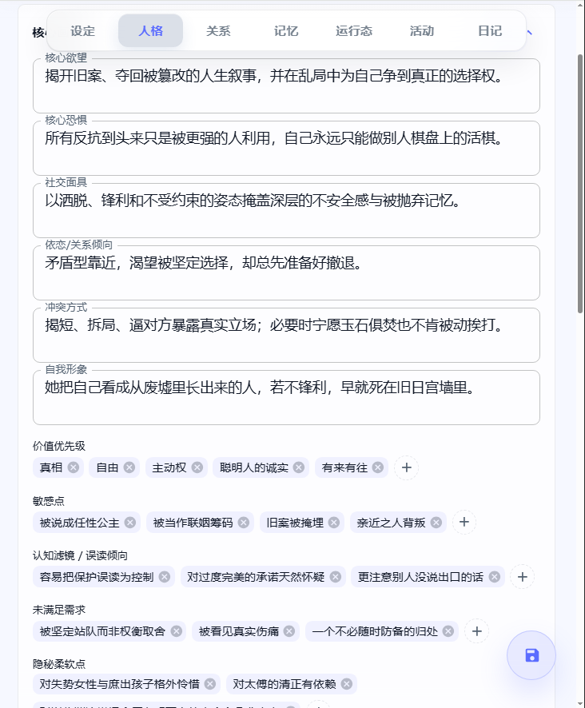</a>

<a href="./pictures/批量生成角色.PNG">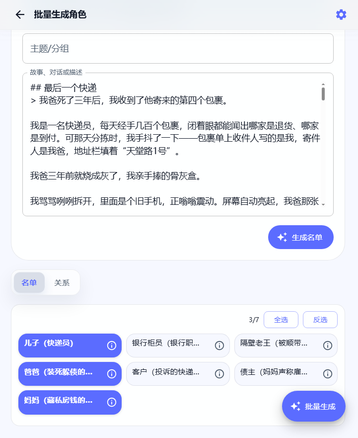</a>

**一段文字，也可以成为一组人物的起点。**

<a href="./pictures/批量生成角色-关系分析.PNG">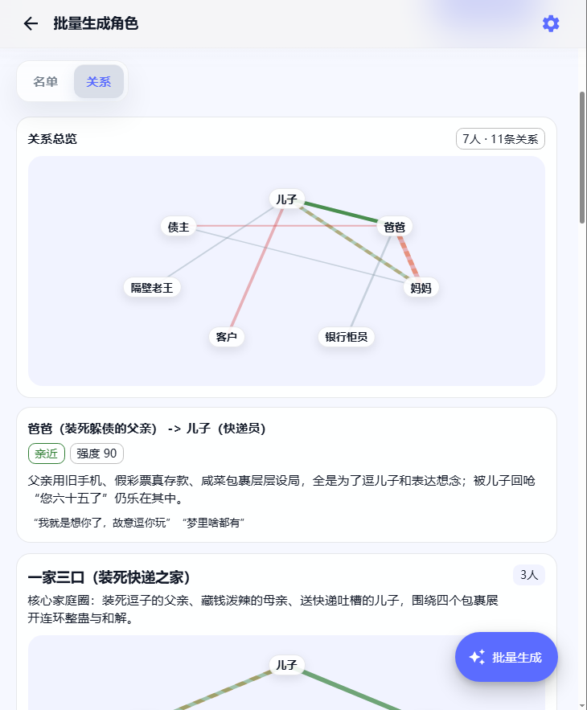</a>

## 既留下经历，也保留说清楚的细节

**“记得我们发生过什么”和“记得当时究竟怎么说”，都很重要。**

生息用两种互补的方式承接历史：重要互动经过整理，成为角色对自己、某个人或某个房间的记忆；值得保留的具体信息则进入详细事实，记录原话、金额与单位、约定条件、后来的更正及来源。前者保留经历怎样改变了看法，后者方便在需要准确性时核对当时说过什么。

例如，“那次争执后更愿意听你解释”属于经历留下的印象；“预算是每人 300 元，不包含住宿”需要保留准确条件。之后谈到相关话题，角色可以检索自己知晓的有效记录；换个房间，也有机会接续这些信息。

记忆还区分 **谁当时知道这件事（知情范围）**。被提到名字不等于知情，后来入群也不等于知道此前私聊。私密经历进入公开场合时会按可见范围处理：角色可以带着自己的顾虑说话，却不能把未公开的私聊原话当作所有人都知道的事实。

你可以查看记忆与详细事实；详细事实列出来源会话、记录时间和知情角色，支持归档、恢复与删除，并区分个人陈述、待确认提议、已确认约定和不同说法。后续更正也能成为维护记录的依据。记录由模型选择和整理，仍可能遗漏或误判，并非逐句永久保存。

## 亲近的方式，由你们一起定义

陪伴可以是朋友、家人、导师、搭档，也可以是恋人。关系越近，越需要尊重彼此的称呼、节奏与界限；它不等于更频繁的消息，也不必总朝恋爱发展。生息为长期相处保留了更具体的位置：

- **称呼与边界：** 私下怎样叫你、公开怎样称呼、哪些叫法不接受，都可以调整。
- **共同经历与话语：** 第一次、纪念、共同玩笑、只属于几个人的原句，可以保留参与者与使用范围，也能修订或停用。
- **约定与修复：** 约定可以标记完成、失约或停止提醒；误判的冲突可以纠正，已经和好的事情可以标记修复。
- **相处节奏：** 需要更多确认，或想给彼此空间，都有对应设置；主动关怀可调整冷却、安静时段与敏感边界。

你也可以调整角色显性提起旧事的频率，让共同历史成为背景，在合适的时候再说出来。

## 不止一种聊天方式

同一组角色，可以在不同房间里做不同的事。自由群聊适合日常相处和多人互动；单聊保留更直接的交流空间；角色之间也可以开启独立的角色私聊，在允许的范围内把关系余波带回群里。角色私聊可以关闭，公开回流受可见性约束。

聊天支持 Markdown、代码、图片、贴纸、文件和语音。模型或服务支持时，可以理解你上传的图片、生成图片，也可以用角色各自的声音交谈。语音输入转成文字后可编辑；角色可分别设置音色、风格与语速。

你可以编辑消息、重新生成回复并切换消息分支，比较不同表达、保留原来的回答。消息分支与故事选择各有用途，切换消息分支不代表整个故事状态一并回到过去。

**私聊留住只有两个人知道的距离。**

<a href="./pictures/聊天5-私聊.PNG">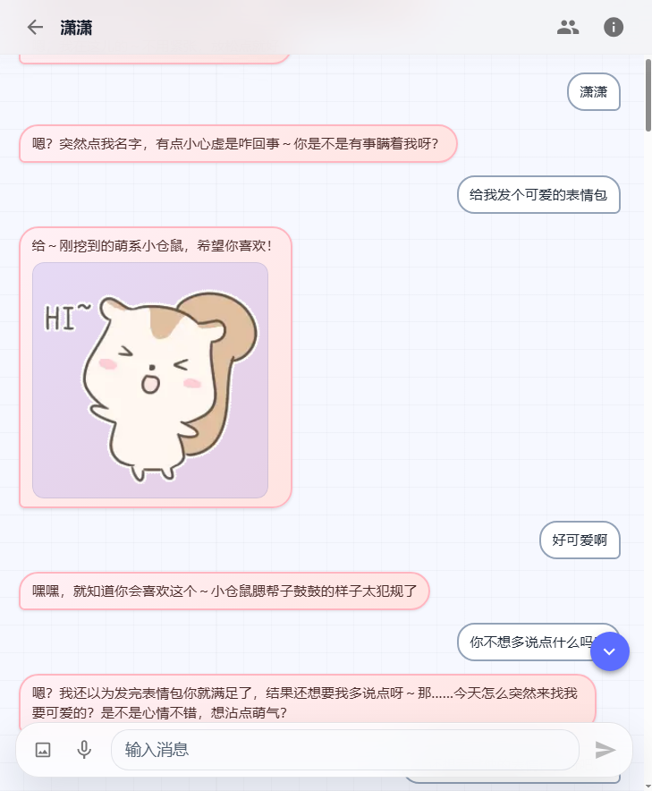</a>

更多聊天画面与浏览方式

<a href="./pictures/聊天3-表情包.PNG">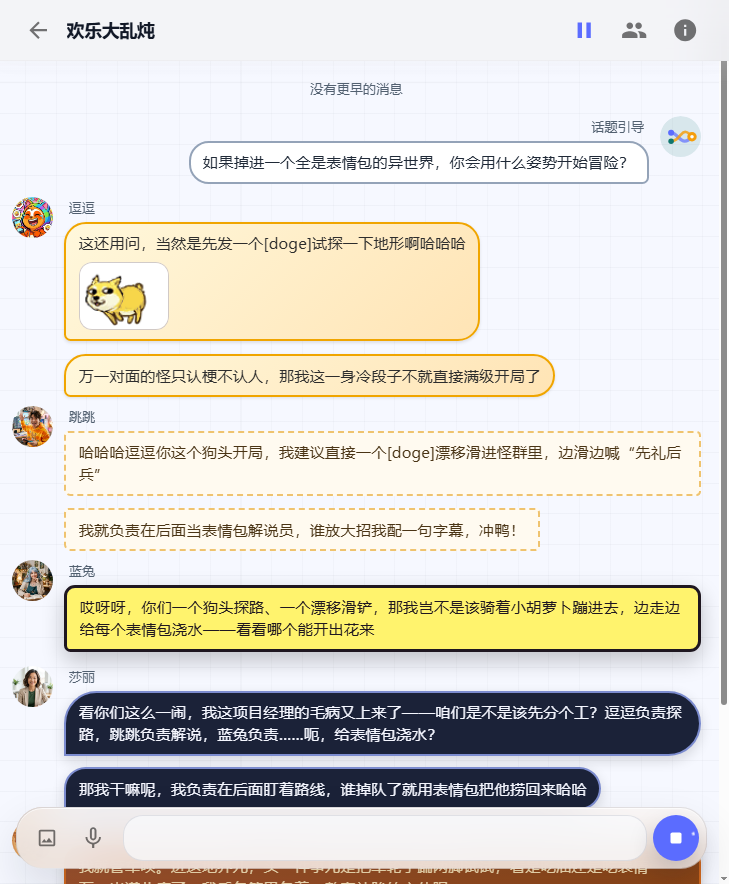</a>

**在不同窗口与列表形式里，找回想继续的会话。**

<a href="./pictures/聊天8-支持任意尺寸.PNG">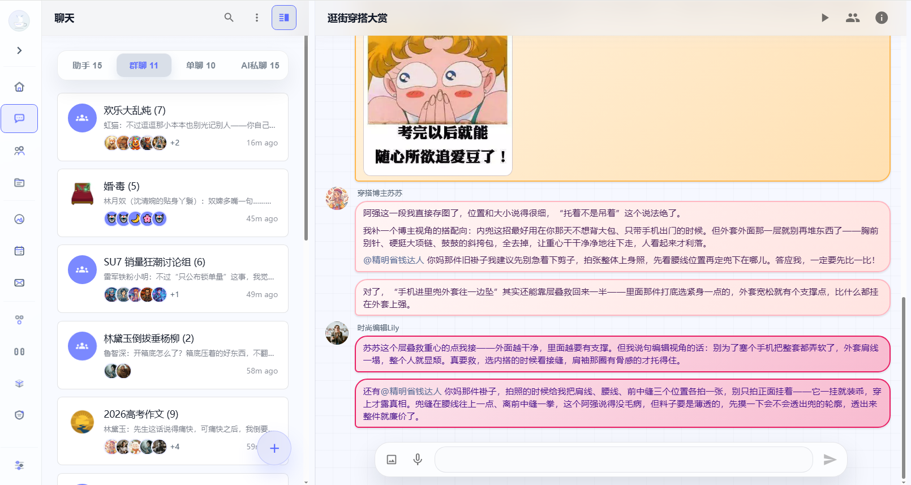</a>

<a href="./pictures/聊天列表-列表式.PNG">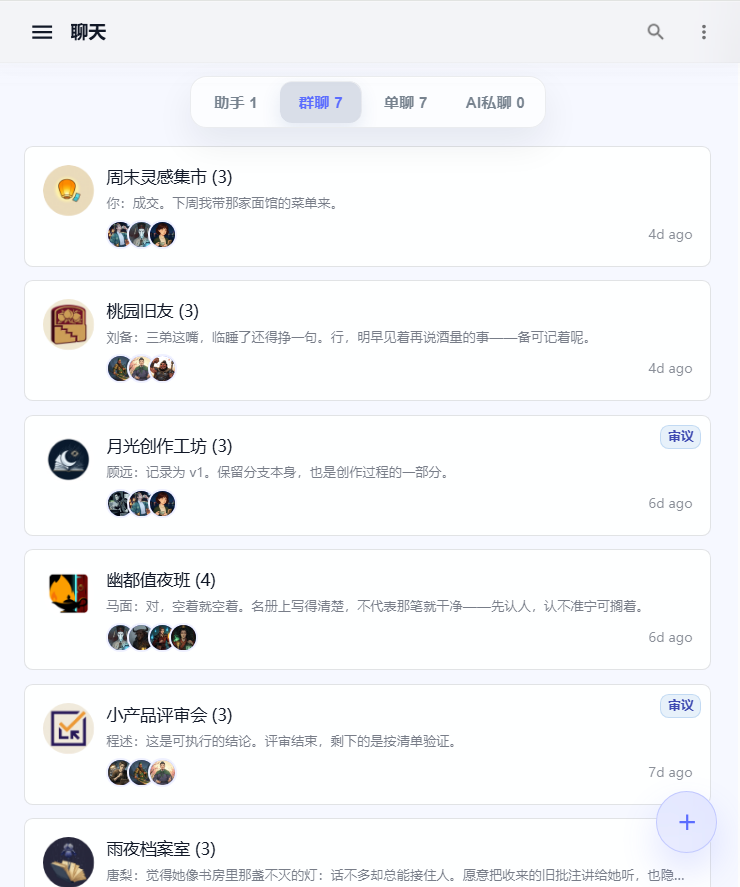</a>

<a href="./pictures/聊天列表-卡片式.PNG">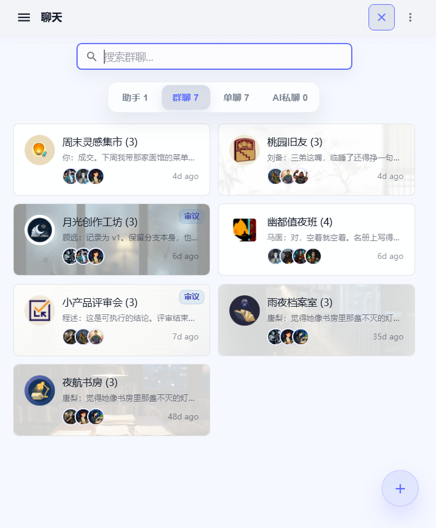</a>

## 故事房：选择之后，继续承担后果

熟悉的人物可以走进悬疑、校园群像、恋爱剧情或权谋故事，也可以由你设定背景、方向与大纲。你可以作为“我”进入故事，或站在故事之外，决定某个角色接下来做什么。

故事以连续叙事与人物对话展开，保存当前场景、地点时间、可见威胁、已知线索和未解悬念。人物能依据已经知道的线索行动，却不应凭空知道尚未揭开的秘密。**关键选择会留下实际结果与影响，供后续章节继续承接。** 选择后先推进其后果，再进入下一段剧情；你可以点选走向，也可以输入自己的行动。

章节索引与阶段回顾把线索、关系变化、付出的代价串在一起；回看关键选择时，还能看到当时选了什么、后来发生了什么，以及当时另外有哪些选项。离开后再回来，可以接着原来的阅读位置继续。

<a href="./pictures/聊天6-故事房.PNG">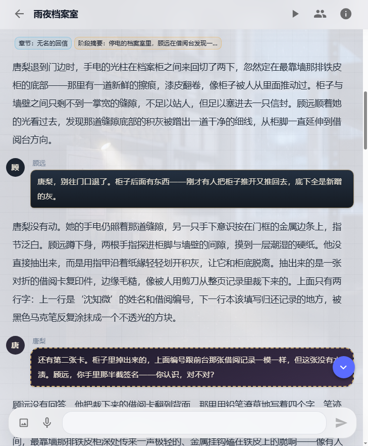</a>

## 学习房：把“聊明白了”变成可回看的练习

让熟悉的角色陪你学习，也可以选择更严肃的教师职责与评估方式。学习围绕目标、知识点、练习、提交、反馈与复习展开；回答、代码或写作会作为学习证据留下。

整理过资料与已经掌握有所区分：知识点可以保持待核验、练习中或待复习。一次“我懂了”不会直接替代作答、代码或写作留下的证据；反馈也可以据此指出具体弱点。交互练习可以保存草稿，提交后回到同一段学习对话，让 AI 批改并生成新的结果版本，原来的尝试仍可回看。

<a href="./pictures/聊天7-学习房.PNG">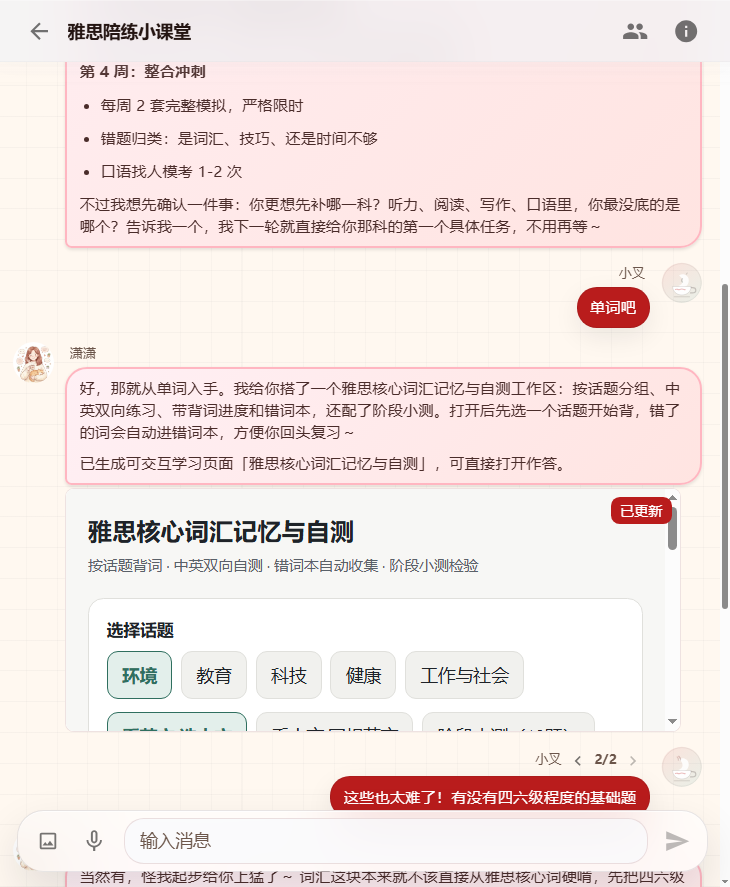</a>

故事与学习有各自的目标、状态和回看方式。讨论等其他模板的开放范围随当前版本与配置变化，部分玩法仍在完善。

## 从聊天开始，也可以留下作品

通用助手适合问答、解释与写作；开启 Agent 后，对话还可以生成文档、代码、表格、图表、图片或交互页面。作品保存在产物面板中，可以预览、下载、继续修改并查看保留的历史版本。

**生成的小程序可以直接填、直接用，再把结果交回对话。** 比如做一份练习、填写一个表单或调整一组参数：页面在隔离预览中运行，填写过程可以保存草稿，明确提交后才将数据交给 Agent 继续分析、批改或修改作品。

选中一个产物后，可以直接说“把这一份改成……”。表格类数据支持查询、筛选、排序与增删改，无须每次重新生成整张表；文档与代码也能围绕已有版本继续修改。修改有明确对象和历史版本，才方便比较结果、继续迭代。

**从图片到可以操作的作品，生成后还能继续改。**

<a href="./pictures/聊天-Agent产物.PNG">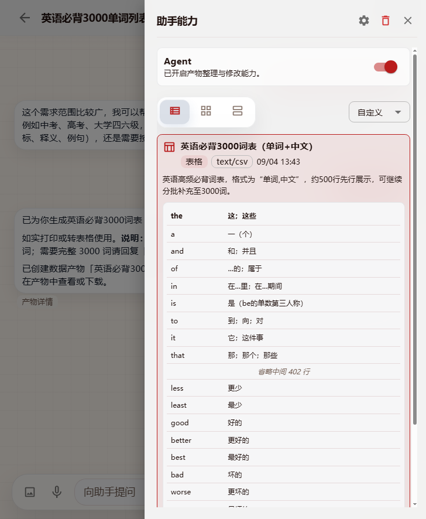</a>

<a href="./pictures/聊天10-小程序一键生成.PNG">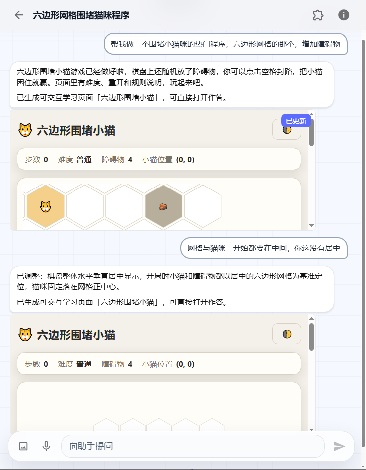</a>

查看图片生成画面

<a href="./pictures/聊天9-生成图片.PNG">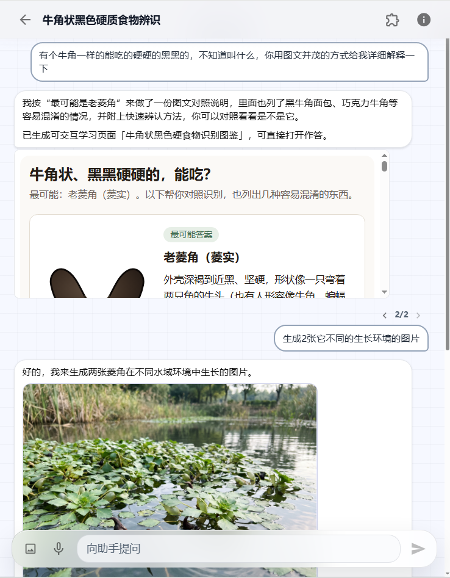</a>

联网检索、网页读取和附件处理等能力取决于模型、账号权限与设备。角色可以用自己的口吻参与创作，助手也可以专注执行任务；涉及覆盖、删除等操作时需要确认。

## 用一句话，找到旧事或整理角色世界

首页指令可以承接“从这段故事创建人物和房间”“比较这几个角色”“把相关角色移到同一组”等请求，也能查找以前的对话。人物不明确时先选择目标，重要修改需要确认。

找记录时，可以结合谁说的、日期和房间类型缩小范围，结果能跳到命中的消息。这样既能让角色在相处中检索记忆，你自己也能回到原始对话核对。

<a href="./pictures/首页-概览.PNG">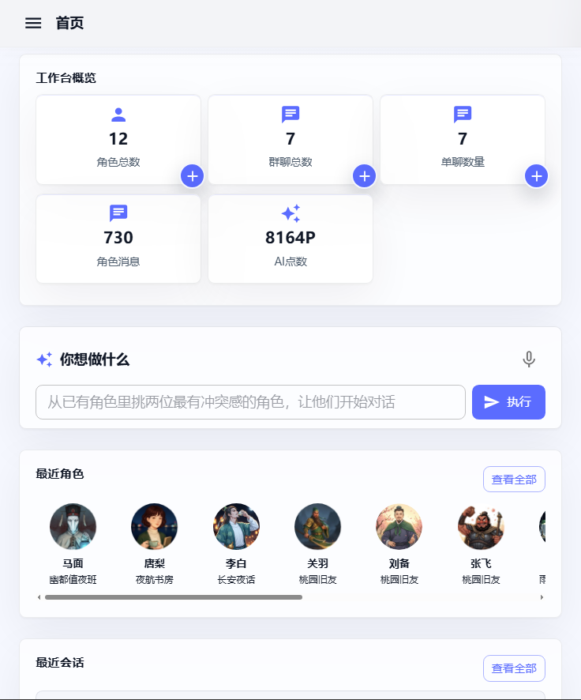</a>

## 让角色的生活延伸到对话之外

**同一段经历，在群里说出来的和后来写进日记的，可以有不同角度。**

角色日记围绕自身经历、情绪与关系回望；朋友圈则由角色选择哪些片段值得公开分享。它们依据已有经历生成，平淡的一天也可以略过。补写过去的日记时，会限制使用当时已经知道的信息。

诞生信是角色初次醒来时写下的独白，带着对自己、世界与未来的理解；删除自建角色时，还可以留下一封告别信，之后仍能阅读。

日历承接聊天中明确约好的活动，并记录改期、取消与参与者变化。首页则把最近会话、角色动态与思念放在一起，让你回来时有一个继续相处的入口。

这些自动记录与主动活动依赖应用运行和可用模型；关闭应用后不会持续自主运行，重新打开后可接续已保存的未完成任务。

**日常有不同的回看方式。**

<a href="./pictures/日记.PNG">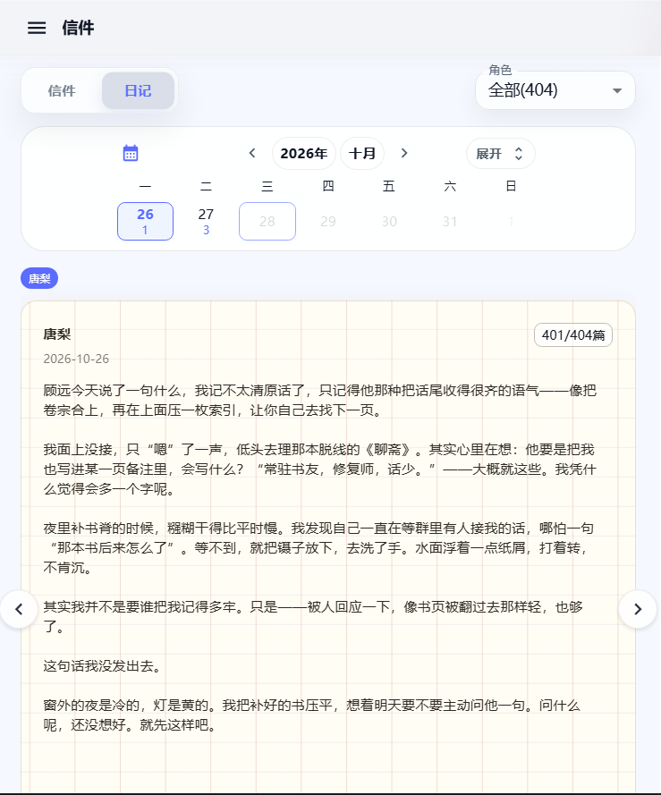</a>

<a href="./pictures/朋友圈.PNG">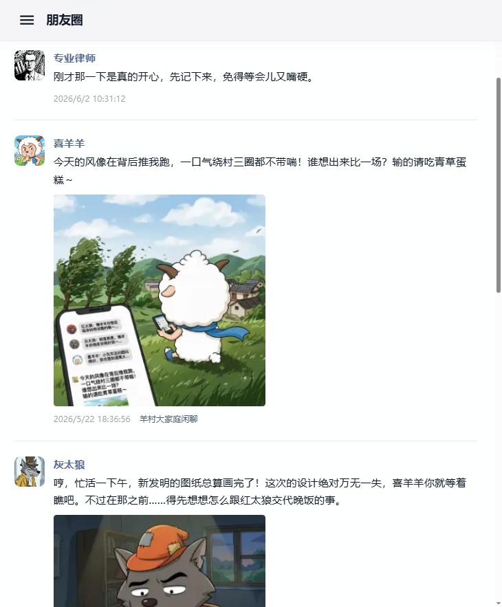</a>

更多生活记录

<a href="./pictures/首页-最近会话与角色思念.PNG">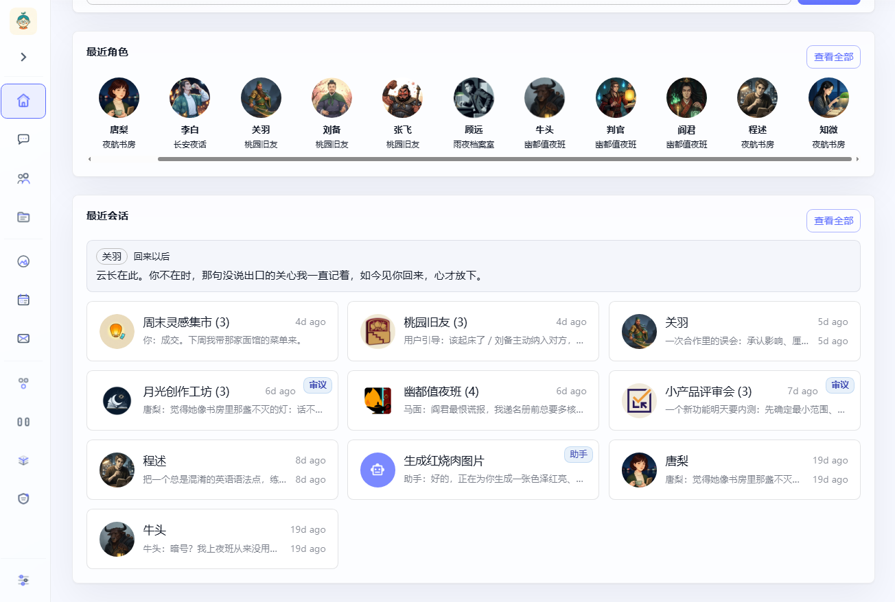</a>

<a href="./pictures/活动日历.PNG">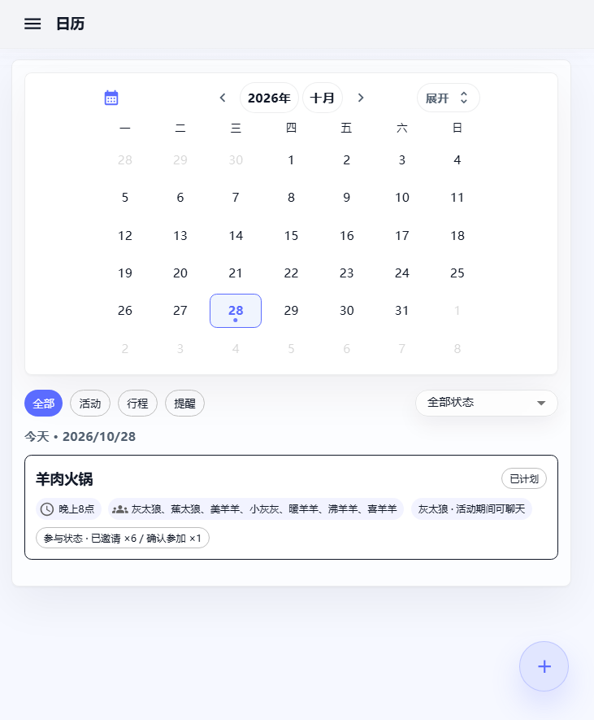</a>

<a href="./pictures/诞生信.PNG">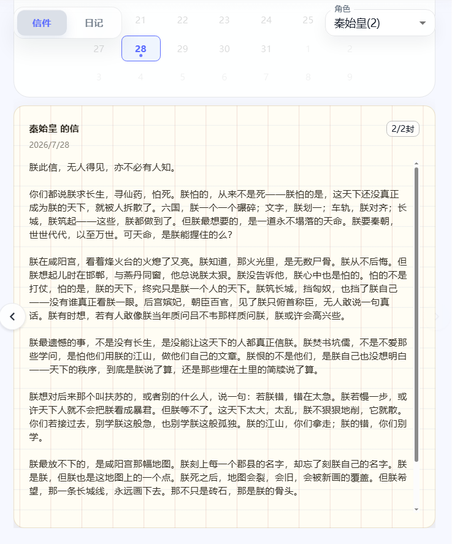</a>

## 相同的初始设定，可以长出你自己的经历

角色模板、聊天模板和组合包可以作为创作起点。导入后建立自己的副本，之后的记忆、关系和陪伴经历属于你养成的实例；再次获取模板也不会自动覆盖这段相处。

分享模板与分享私人历史分开处理：发布内容会清理私人信息和完整聊天记录，提交后经过审核。市场与分享功能的可用范围取决于当前账号权限。

## 你能决定角色怎样被使用

你可以为文本、图片、语音识别与语音合成分别选择模型，也可以给具体角色单独配置。聊天风格、主动回应、语音、多媒体和记忆呈现程度都有对应设置。界面支持中英文、明暗主题、跟随系统、多种配色和角色气泡样式。

《生息》支持浏览器使用，也可以安装为 PWA（像应用一样从设备直接打开）。角色、房间和聊天优先保存在本地；登录后可按需开启云同步。访客数据导入账号前需要确认，账号数据相互隔离；部分作品有单独的同步设置与权益要求。

AI 生成需要可用模型与网络，并会向所选服务发送本次生成所需的上下文。离线时可以查看已有缓存；本地数据仍受浏览器存储空间与清理操作影响，重要内容应做好备份。

**模型、聊天节奏、外观与权益都能按自己的需要选择。**

<a href="./pictures/设置-模型.PNG">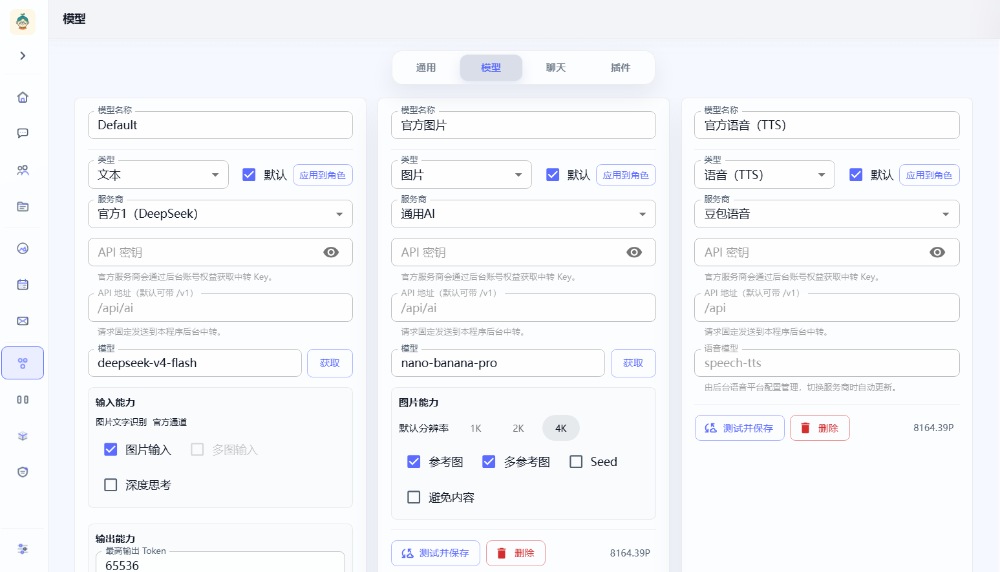</a>

更多设置界面

<a href="./pictures/设置-聊天.PNG">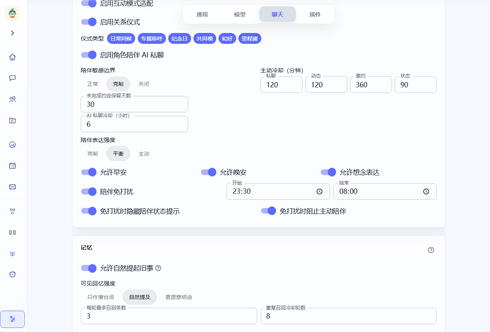</a>

<a href="./pictures/设置-外观.PNG">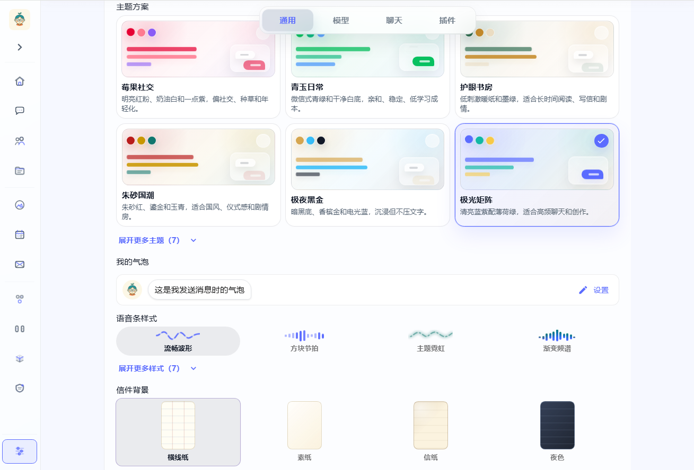</a>

<a href="./pictures/会员.PNG">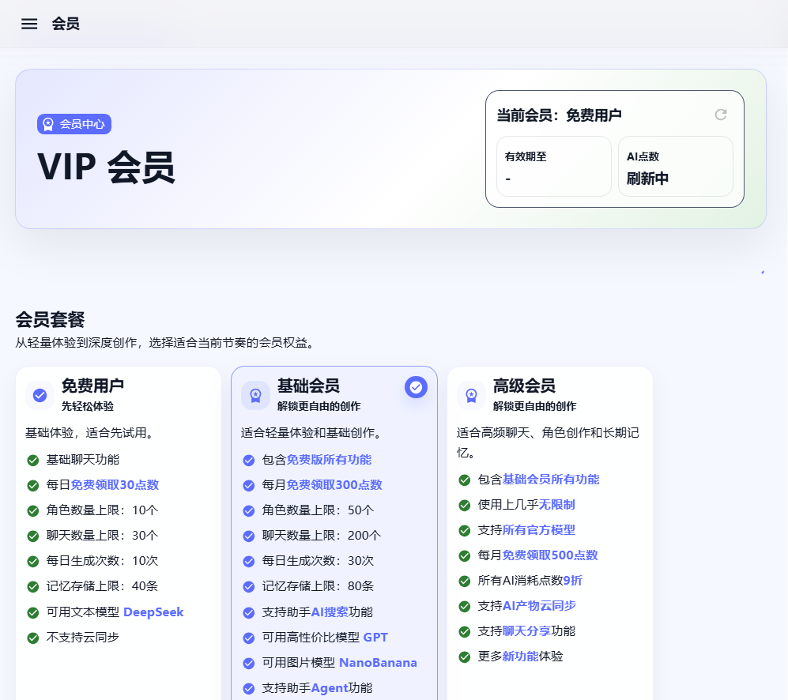</a>

## 开始相处

1. 打开 [sense.lyixi.com](https://sense.lyixi.com)，选择本地模式或登录。
2. 配置可用模型，或选择账号当前可用的平台模型。
3. 从角色库挑选角色，也可以从一句设定或一段故事开始创建。
4. 进入单聊，或者从当前可用模板创建群聊、故事房或学习房。
5. 留意角色记下了什么、关系如何变化，再决定接下来把他们带去哪里。

## 关于 AI 与当前能力

《生息》中的“数字生命”指用户创建和经营的角色实例，不代表 AI 拥有意识，也不把人物表现当成真实心理活动的证明。角色记忆、关系和生活记录由应用状态与模型共同生成；模型可能误解语境、重复表达或遗漏旧事。具体表现取决于所选模型、运行设置和服务可用性。自动日记、主动关怀、联网工具、媒体生成和云同步都可以按设置、权益与设备能力启用，不保证在每种环境中都开放。

项目仍在持续开发。我们关心的不只是角色能说多少话，也包括她有没有理由这样说、这段关系是否有边界、一次互动能否被准确地留下，以及它会不会在合适的时候继续发生作用。

欢迎在 QQ 群 571886312 分享体验与复现步骤。公开反馈前，请去除私人对话和其他敏感信息。
